# Codyssey_02 — 나만의 퀴즈 게임

## 프로젝트 개요

Python으로 만든 터미널 퀴즈 게임입니다.
퀴즈 풀기, 추가, 목록 보기, 최고 점수 확인 기능을 제공합니다.
추가한 퀴즈와 최고 점수를 JSON 파일에 저장하여 다음 실행에서도 사용할 수 있습니다.

Python의 입력과 출력, 조건문, 반복문, 함수, 클래스, 파일 입출력과 예외 처리를 학습했습니다.
Git으로 기능별 변경 이력을 관리하고, 브랜치를 만들어 작업한 뒤 병합했습니다.

## 퀴즈 주제와 선정 이유

- 주제: AI와 개발 기초
- 선정 이유: AI를 활용한 개발을 배우면서 알아두면 좋은 기초 내용을 퀴즈로 복습하기 위해 선택했습니다.
- 기본 문제 수: 5개
- 문제 형식: 선택지 4개, 정답 번호 1~4

## 개발 환경

- 운영체제: Windows
- Python: 3.13.17
- Git: 2.56.0.windows.4
- VS Code: 1.145.2
- 터미널: PowerShell

외부 라이브러리는 사용하지 않으며, Python 표준 라이브러리를 사용합니다.


## 실행 방법

Python 3.10 이상이 필요합니다.
프로젝트 폴더에서 다음 명령을 실행합니다.

```powershell
python main.py
```

저장 파일이 없으면 기본 퀴즈 5개로 시작합니다.
정상적인 저장 파일이 있으면 저장된 퀴즈와 최고 점수를 불러옵니다.

### 메뉴와 기능

| 번호 | 기능 | 설명 |
|---|---|---|
| 1 | 퀴즈 풀기 | 등록된 모든 문제를 풀고 정답 수와 점수를 확인합니다. |
| 2 | 퀴즈 추가 | 문제, 선택지 4개, 정답 번호를 입력하고 저장합니다. |
| 3 | 퀴즈 목록 | 등록된 문제 수와 문제 문장을 확인합니다. |
| 4 | 점수 확인 | 저장된 최고 점수를 확인합니다. |
| 5 | 표시 언어 설정 | 한국어 또는 영어를 선택하고 설정을 저장합니다. |
| 6 | 종료 | 데이터 저장을 시도하고 프로그램을 종료합니다. |

메뉴와 안내 메시지는 한국어 또는 영어로 표시합니다.
문제와 선택지의 내용은 자동 번역하지 않고 원문을 유지합니다.

아래 메뉴 화면은 초기 개발 단계의 기록입니다.
당시에는 5번이 종료였으며, 현재는 언어 설정이 추가되어 6번이 종료입니다.


## 입력 검증과 안전 종료

- read_int()로 숫자 입력을 검사합니다.
- 입력 앞뒤 공백을 제거합니다.
- 빈 입력, 정수로 바꿀 수 없는 입력, 허용 범위 밖 숫자는 안내 후 다시 입력받습니다.
- read_text()로 문제와 선택지의 빈 입력을 거절합니다.
- Ctrl+C와 EOF가 발생하면 안내 메시지를 표시하고 저장을 시도한 뒤 종료합니다.
- 등록에 필요한 입력이 모두 끝나기 전에는 문제를 목록에 추가하지 않습니다.
- 퀴즈가 없으면 안내 후 메뉴로 돌아갑니다.

## 파일 구조

| 경로 | 역할 |
|---|---|
| main.py | QuizGame 클래스, 입력 검증, 게임 진행, 언어 설정, 저장과 불러오기 |
| quiz.py | 개별 문제를 표현하는 Quiz 클래스 |
| default_quizzes.py | 기본 퀴즈 5개를 Quiz 객체 목록으로 생성 |
| test_main.py | 언어 설정과 관련 입력 검증의 자동 테스트 |
| README.md | 프로젝트 설명과 실행 방법 |
| .gitignore | Git 관리에서 제외할 파일 지정 |
| docs/test-results.md | 기능별 테스트 결과 |
| docs/screenshots/ | 실행 결과와 Git 작업 화면 |
| state.json | 실행 중 생성되는 퀴즈와 최고 점수 저장 파일 |
| language.json | 실행 중 생성되는 표시 언어 설정 파일 |
| test_state.py | 저장 파일 읽기·쓰기·교체·백업 실패 시 데이터 보호 검사 |

state.json과 language.json은 개인 실행 데이터이므로 Git 관리에서 제외합니다.

## 클래스와 함수의 역할

### Quiz 클래스

문제 한 개의 정보와 동작을 담당합니다.

| 종류 | 이름 | 역할 |
|---|---|---|
| 속성 | question | 문제 문장 |
| 속성 | choices | 선택지 4개 |
| 속성 | answer | 정답 번호 |
| 메서드 | display() | 문제와 선택지 출력 |
| 메서드 | check_answer() | 입력한 번호가 정답인지 확인 |
| 메서드 | to_dict() | 객체를 저장 가능한 딕셔너리로 변환 |
| 메서드 | from_dict() | 딕셔너리를 검증하고 Quiz 객체로 복원 |

문제와 선택지의 형식, 정답 번호가 올바른지 검사합니다.

### QuizGame 클래스

게임 전체의 상태와 메뉴 진행을 관리합니다.

| 속성 | 역할 |
|---|---|
| quizzes | 현재 퀴즈 목록 |
| best_score | 최고 점수 또는 기록이 없는 상태인 None |
| language | 표시 언어 |
| can_save | 현재 실행에서 데이터 저장을 허용하는지 나타내는 값 |

주요 메서드는 다음과 같습니다.

- show_menu(): 메뉴 표시
- play_quiz(): 퀴즈 진행과 최고 점수 갱신 및 저장
- add_quiz(): 문제 등록 및 저장
- show_quizzes(): 문제 목록 표시
- show_score(): 최고 점수 표시
- configure_language(): 표시 언어 설정
- load_state(): 퀴즈와 최고 점수 불러오기
- save_state(): 퀴즈와 최고 점수 저장
- run(): 메뉴 반복과 종료 예외 처리

객체를 생성할 때 기본 데이터를 준비하고 저장 파일을 불러옵니다.
정상적인 저장 파일이 있으면 그 내용으로 문제 목록과 최고 점수를 설정합니다.
메뉴 표시와 퀴즈 진행 등 일부 동작은 별도의 함수를 활용합니다.

### 역할을 나눈 이유

Quiz는 문제 하나의 정보와 정답 확인을 담당합니다.
QuizGame은 여러 문제와 최고 점수를 관리하며 게임을 진행합니다.

공통 입력 검증은 read_int()와 read_text()로 분리했습니다.
입력 규칙을 여러 기능에서 재사용하고, 규칙이 바뀌면 한곳에서 수정하기 위해서입니다.

파일 처리는 load_state()와 save_state()로 분리하여
게임 진행과 저장 오류 처리를 각각 이해하고 수정하기 쉽게 했습니다.

## 퀴즈 풀기

- 등록된 문제를 순서대로 출제합니다.
- 각 문제에서 정답 또는 오답을 안내합니다.
- 오답이면 정답 번호를 표시합니다.
- 모든 문제를 풀면 정답 수와 100점 만점의 점수를 표시합니다.
- 퀴즈가 없으면 안내 후 메뉴로 돌아갑니다.

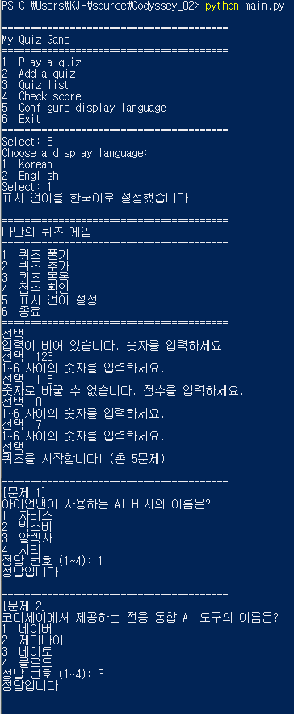

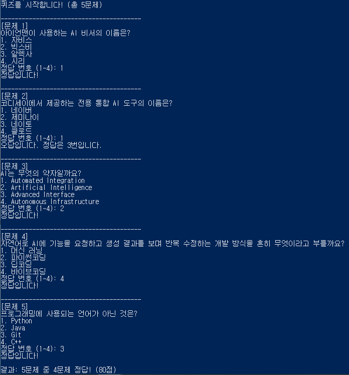


## 퀴즈 추가

- 문제, 선택지 4개, 정답 번호를 입력받습니다.
- 문제와 선택지의 앞뒤 공백을 제거하고 빈 입력을 거절합니다.
- 정답 번호가 1~4 사이의 정수인지 검사합니다.
- 모든 입력이 끝나면 Quiz 객체를 만들어 목록에 추가하고 저장합니다.
- 저장에 성공한 문제는 다음 실행에서도 불러옵니다.

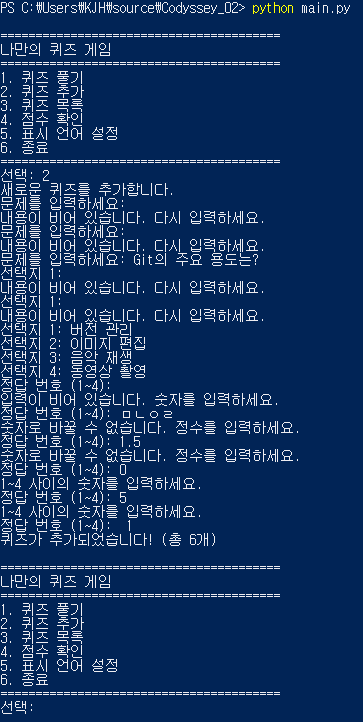


## 퀴즈 목록 보기

- 등록된 문제 수와 문제 문장을 표시합니다.
- enumerate()를 사용해 문제에 1번부터 번호를 붙입니다.
- 빈 목록이면 안내 후 메뉴로 돌아갑니다.
- 목록 제목은 표시 언어를 따르며 문제 문장은 원문을 유지합니다.

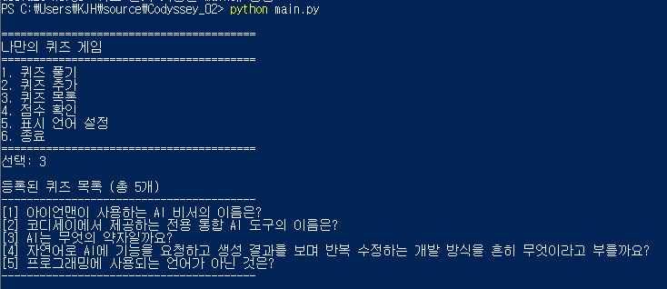


## 최고 점수 확인

- 점수는 정답 수 / 전체 문제 수 × 100을 round()로 반올림해 계산합니다.
- 끝까지 완료한 게임의 점수만 최고 점수와 비교합니다.
- 첫 기록이거나 기존 최고 점수보다 높으면 갱신합니다.
- 같거나 낮은 점수라면 기존 최고 점수를 유지합니다.
- None은 아직 완료한 게임 기록이 없다는 뜻입니다.
- 0점은 게임을 완료했지만 정답이 없었다는 뜻입니다.
- 최고 점수를 파일에 저장하여 다음 실행에서도 유지합니다.
- 메뉴 4번에서 최고 점수를 확인합니다.

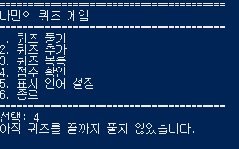

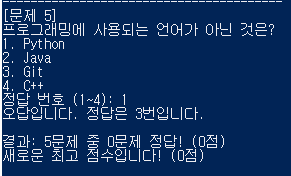


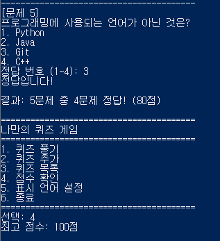

## 데이터 파일: state.json

퀴즈 목록과 최고 점수는 프로젝트 루트의 state.json에 UTF-8로 저장합니다.
프로젝트 루트는 main.py가 있는 폴더입니다.
저장 경로를 main.py의 위치를 기준으로 정하므로 실행 명령을 입력한 폴더가 달라도 같은 파일을 사용합니다.

### JSON을 선택한 이유와 데이터가 커졌을 때의 한계

이 게임은 기본 퀴즈 5개로 시작합니다. JSON을 사용하면 한 문제의 문장,
선택지 4개, 정답 번호를 한 묶음으로 저장할 수 있습니다. 사람이 파일을
열어 내용을 읽을 수 있고, Python 표준 라이브러리로 처리할 수 있습니다.

문제가 1,000개일 때 문제 하나를 추가하면 `save_state()`는 1,001개 문제
전체를 딕셔너리 목록으로 만들어 다시 저장합니다. 최고 점수 하나만 바뀌어도
문제 전체를 다시 씁니다. 따라서 저장할 데이터가 늘수록 쓰는 시간도 늘어납니다.

시작할 때는 `load_state()`가 파일 전체를 읽어 `Quiz` 객체로 복원합니다.
복원 중에는 읽어 온 딕셔너리와 새 객체가 함께 메모리에 있고, 저장할 때도
기존 객체에 더해 저장용 목록이 필요합니다. 문제 수와 문장 길이가 늘면
필요한 메모리도 커집니다.

문제 검색과 개별 수정이 잦아진다면 SQLite를 고려할 수 있습니다.
퀴즈와 점수를 별도 테이블로 관리하면 필요한 문제만 조회하거나,
최고 점수가 바뀔 때 점수 기록만 갱신할 수 있습니다.

### 데이터 구조

아래는 구조를 설명하기 위해 문제 한 개만 표시한 예시입니다.
실제 기본 퀴즈는 5개입니다.

```json
{
  "quizzes": [
    {
      "question": "Git의 주요 용도는?",
      "choices": ["버전 관리", "이미지 편집", "음악 재생", "동영상 촬영"],
      "answer": 1
    }
  ],
  "best_score": null
}
```

| 항목 | 의미 |
|---|---|
| quizzes | 퀴즈들을 담은 목록 |
| question | 문제 문장 |
| choices | 선택지 4개를 담은 목록 |
| answer | 정답 선택지 번호인 1~4의 정수 |
| best_score | 최고 점수인 0~100의 정수 또는 기록이 없는 상태인 null |

Python의 None은 JSON 파일에서 null로 저장됩니다.
퀴즈 객체는 딕셔너리로 변환한 뒤 JSON으로 저장하고,
불러올 때는 딕셔너리를 검증하여 Quiz 객체로 복원합니다.

### 불러오기와 저장 시점

- 프로그램 시작 시 저장 파일을 불러옵니다.
- 파일이 없으면 기본 퀴즈 5개와 최고 점수 기록이 없는 상태로 시작합니다.
- 퀴즈 등록을 완료하면 저장합니다.
- 모든 문제를 풀면 최고 점수를 비교하고 데이터를 저장합니다.
- 정상 종료와 Ctrl+C·EOF 종료 시 저장을 시도합니다.
- 등록 도중 입력이 중단되면 미완성 문제는 추가하지 않습니다.

### 오류 처리와 데이터 보호

- JSON 문법이나 데이터 구조가 잘못되면 안내 메시지를 표시합니다.
- 손상 파일은 state.json.corrupt-날짜와시간.bak 형태로 보관합니다.
- 손상 파일 백업에 성공하면 기본 데이터로 시작하고 이후 정상 파일을 저장합니다.
- 읽기 오류나 손상 파일 백업 실패 시 해당 실행에서는 저장을 막아 기존 파일을 보호합니다.
- 저장할 때는 먼저 state.json.tmp에 기록한 뒤 state.json으로 교체합니다.
- 저장 오류가 발생하면 실패 안내를 표시합니다.

손상 파일 백업은 손상된 내용을 보관하는 기능입니다.
손상되기 전 데이터를 자동으로 되살리는 기능은 아닙니다.

### Git 관리

state.json과 관련 임시·백업 파일은 .gitignore로 Git 관리에서 제외합니다.
저장소를 처음 복제한 사용자는 기본 퀴즈로 시작하며,
프로그램이 저장에 성공하면 자신의 state.json이 생성됩니다.

### 저장 기능 확인 화면

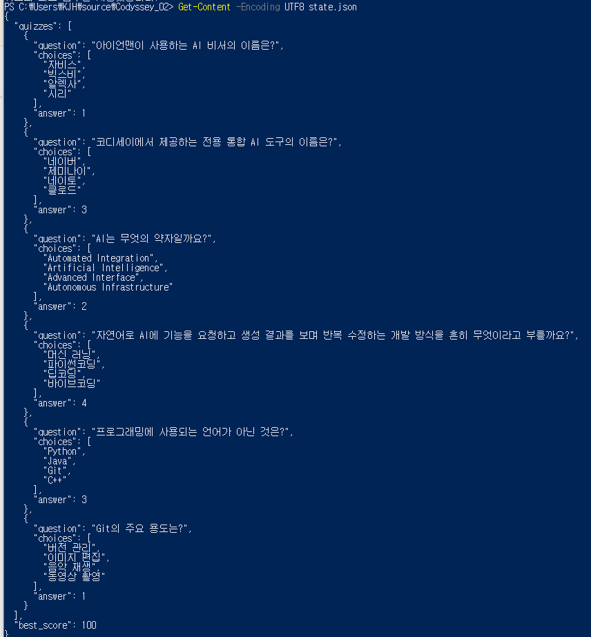

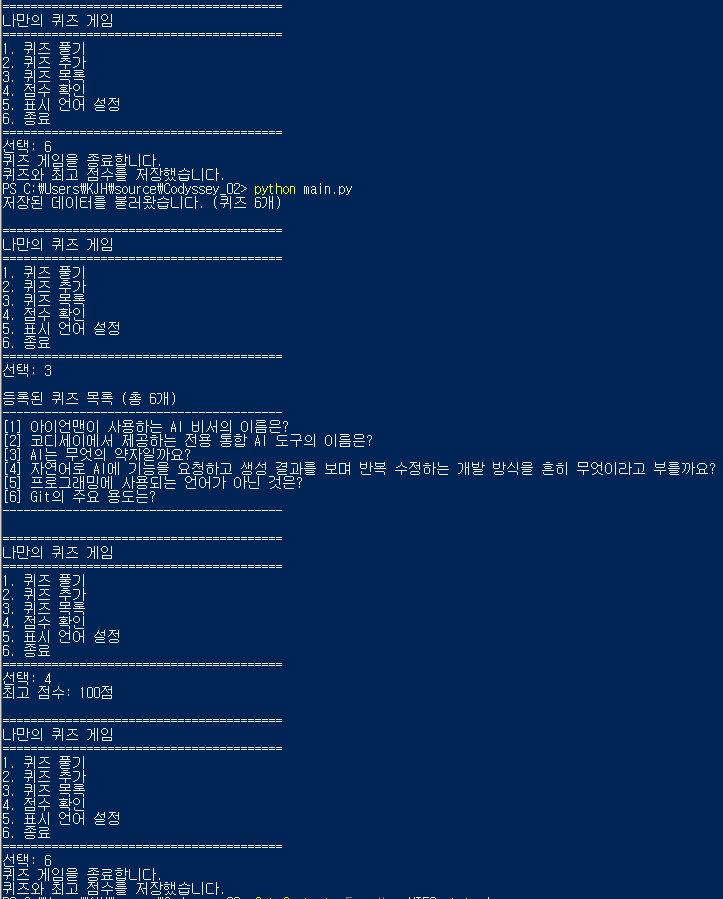

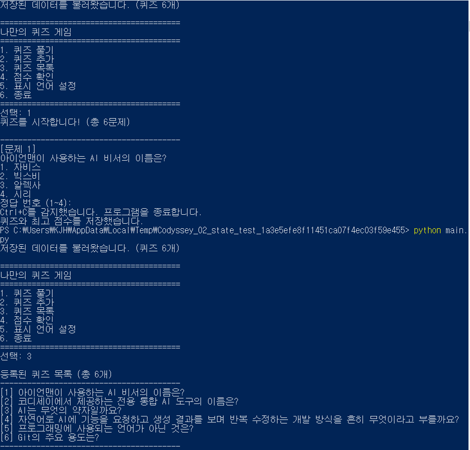


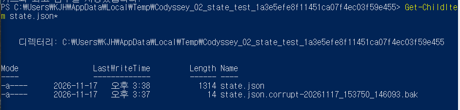

## 언어 설정 파일: language.json

- 표시 언어 설정을 프로젝트 폴더의 language.json에 저장합니다.
- 파일이 없으면 한국어로 시작합니다.
- 파일이 손상되었거나 지원하지 않는 설정이면 안내 후 한국어로 시작합니다.
- 메뉴에서 언어를 선택하면 설정을 저장합니다.
- 개인별 설정 파일은 Git 관리에서 제외합니다.
- 퀴즈와 최고 점수는 별도의 state.json에서 관리합니다.

## 테스트

자동 테스트는 프로젝트 폴더에서 다음 명령으로 실행합니다.

```powershell
python -m unittest -v test_main test_state
```

- test_main.py: 언어 설정 관련 검사 8개
- test_state.py: 저장 파일 오류 처리 검사 4개
- 실행 결과: 총 12개 통과(OK)

저장 파일 오류 검사는 임시 폴더와 unittest.mock.patch를 사용합니다.
읽기·쓰기·교체·백업 실패를 모의로 발생시켜 기존 파일이 보호되는지 확인합니다.

퀴즈 기능, 입력 오류, 재실행 후 데이터 유지, Ctrl+C·EOF 종료,
저장 파일이 없거나 손상된 상황은 수동으로도 검사했습니다.

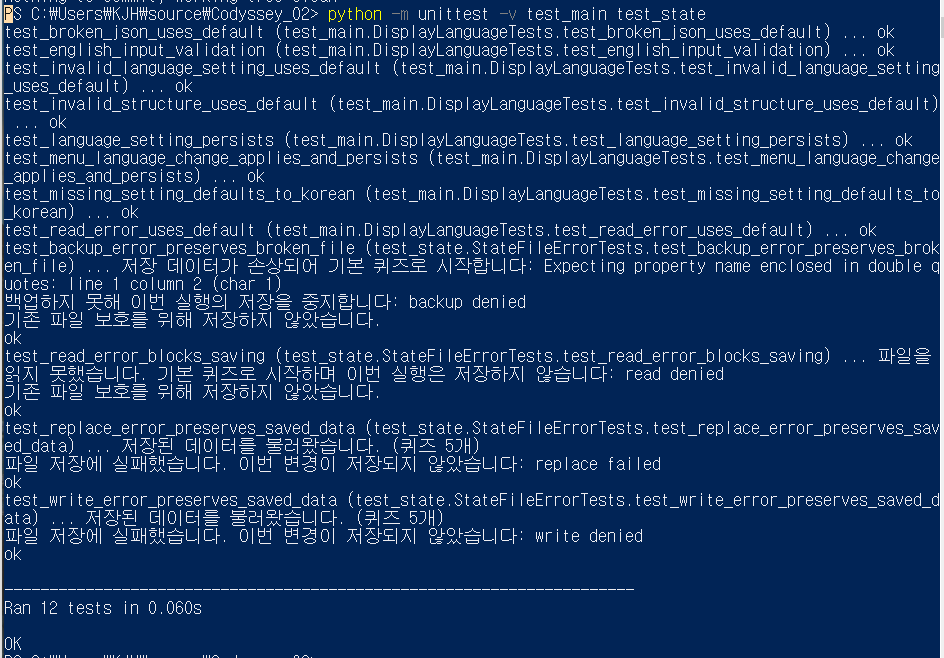

자세한 검사 조건과 결과는 [기능 테스트 기록](docs/test-results.md)에 정리했습니다.

## Git 작업 기록

기능 구현과 오류 수정, 문서 정리를 의미 있는 단위로 나누어 커밋했습니다.

커밋 메시지는 변경 내용에 따라 다음 접두어를 사용했습니다.

- Feat: 기능 추가
- Fix: 오류 수정
- Refactor: 코드 구조 개선
- Docs: 문서 작성과 수정
- Chore: 초기 설정 등 관리 작업

### 브랜치 작업과 병합

1. main에서 git checkout -b feature/play로 작업 브랜치를 생성했습니다.
2. feature/play에서 퀴즈 출제·채점·결과 표시 기능을 구현하고 커밋했습니다.
3. main으로 이동한 뒤 git merge --no-ff feature/play로 병합했습니다.
4. 병합한 main을 GitHub에 업로드했습니다.

--no-ff 옵션을 사용해 별도의 병합 커밋을 남겼습니다.


전체 변경 이력은 다음 명령으로 확인할 수 있습니다.

```powershell
git log --oneline --graph --all
```

### clone과 pull 실습

1. GitHub 저장소를 Codyssey_02_clone 폴더에 복제했습니다.
2. 복제본의 README에 ‘복제본 수정 확인’ 문장을 추가했습니다.
3. 복제본에서 commit과 push를 수행했습니다.
4. 원래 작업 폴더인 Codyssey_02에서 git pull --ff-only를 실행했습니다.
5. 원래 폴더에도 추가한 문장과 같은 커밋 번호가 반영됐는지 확인했습니다.

복제본에서 만든 커밋:
fbdcca8 — Docs: clone 복제본에서 README 수정 실습 기록

사용한 주요 명령:

```powershell
git clone https://github.com/KMJ-lroise/Codyssey_02.git Codyssey_02_clone
git add README.md
git commit -m "Docs: clone 복제본에서 README 수정 실습 기록"
git push
```

### 전체 커밋과 병합 기록

기능별 구현과 오류 수정, 문서 작업을 나누어 커밋했습니다.
feature/play에서 구현한 퀴즈 풀기 기능을 main에 병합했습니다.

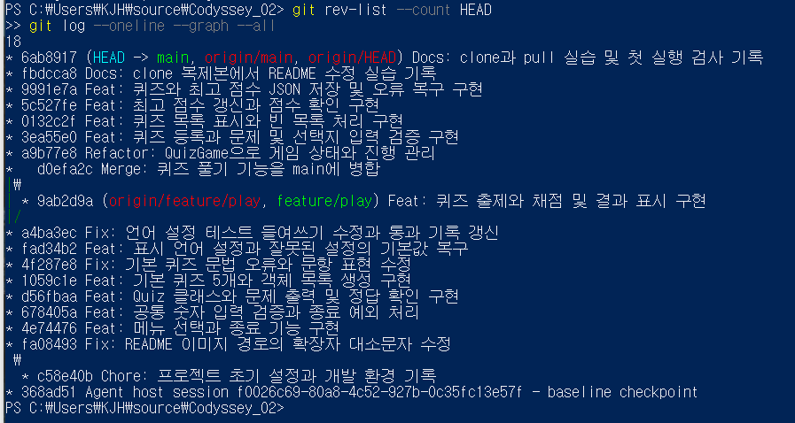

2026-11-18에 `git fetch origin`으로 GitHub의 이력을 가져온 뒤,
`git rev-list --count origin/main`을 실행한 결과는 **22개**였습니다.
집계 기준은 `360ca84`이며, `git rev-list --count 360ca84`로 같은 결과를 확인할 수 있습니다.

[GitHub에서 전체 커밋 이력 보기](https://github.com/KMJ-lroise/Codyssey_02/commits/main/)

| 대표 커밋 | 작업 내용 |
|---|---|
| `4e74476` | 메뉴 번호 선택과 종료 기능 구현 |
| `678405a` | 공통 숫자 입력 검증과 종료 예외 처리 |
| `d56fbaa` | Quiz 클래스에 문제 출력과 정답 확인 구현 |
| `1059c1e` | 기본 퀴즈 5개를 객체 목록으로 생성 |
| `9ab2d9a` | feature/play 브랜치에서 퀴즈 출제·채점·결과 표시 구현 |
| `d0efa2c` | 퀴즈 풀기 기능을 main에 병합 |
| `3ea55e0` | 새 문제·선택지·정답 번호를 검증하고 등록 |
| `0132c2f` | 퀴즈 목록 표시와 빈 목록 처리 |
| `5c527fe` | 완료한 게임의 점수로 최고 점수 갱신 |
| `9991e7a` | 퀴즈와 최고 점수를 JSON에 저장하고 저장 오류 처리 |
| `d015547` | 파일 작업 실패 시 기존 데이터를 보호하는지 테스트 |