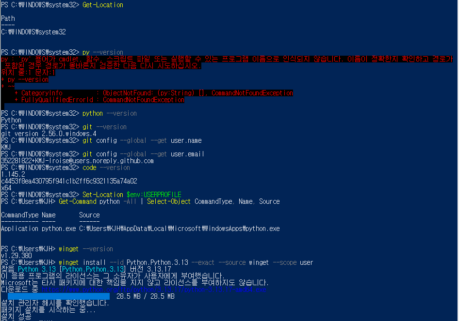
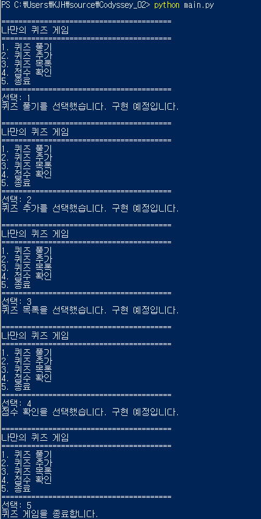

# Codyssey_02 — 나만의 퀴즈 게임

## 프로젝트 개요
Python으로 터미널에서 동작하는 퀴즈 게임을 만드는 학습 프로젝트입니다.
입력과 출력, 조건문, 반복문, 함수, 클래스, JSON 파일 저장을 학습합니다.
Git으로 기능별 변경 이력을 관리합니다.

## 현재 진행 상황
- 개발 환경 확인 완료
- GitHub 저장소 생성과 첫 업로드 완료
- 메뉴 표시, 번호 선택, 정상 종료 구현
- 잘못된 메뉴 입력 시 안내 후 다시 입력받도록 구현
- 퀴즈 풀기·추가·목록·점수 기능은 구현 예정

## 개발 환경
- 운영체제: Windows
- Python: 3.13.17
- Git: 2.56.0.windows.4
- VS Code: 1.145.2
- 터미널: PowerShell

## 개발 환경 확인 화면




## 실행 방법
Python 3.10 이상이 필요합니다.
프로젝트 폴더에서 다음 명령을 실행합니다.

```powershell
python main.py
```

현재는 메뉴 선택과 종료 기능까지 구현되어 있습니다.
1~4번은 선택 확인 메시지를 출력하며, 5번은 프로그램을 종료합니다.

## 메뉴 실행 화면



## 입력 및 종료 처리
- 숫자 입력 검증을 read_int() 함수로 분리했습니다.
- 앞뒤 공백, 빈 입력, 정수 변환 실패, 허용 범위 밖 입력을 처리합니다.
- Ctrl+C와 EOF 발생 시 안내 후 종료합니다.
- 종료 시 데이터 저장은 파일 저장 기능 구현 단계에서 추가할 예정입니다.

[기능 테스트 기록 보기](docs/test-results.md)