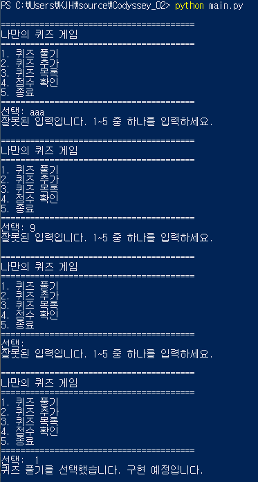
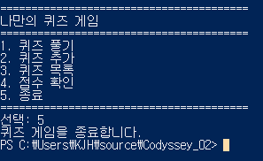
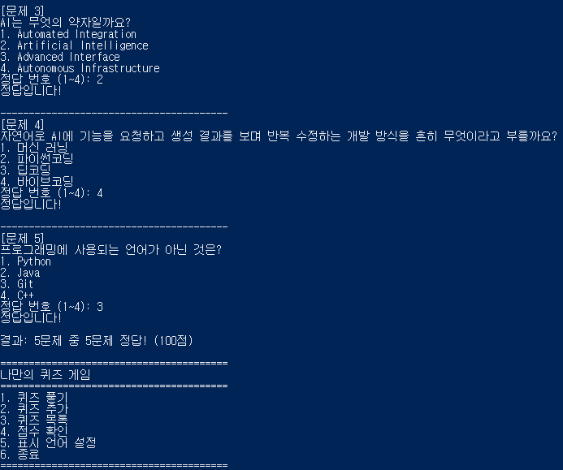
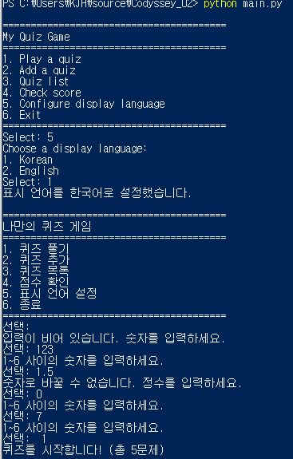
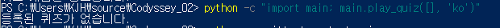
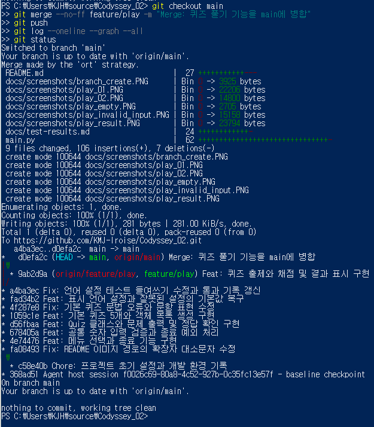
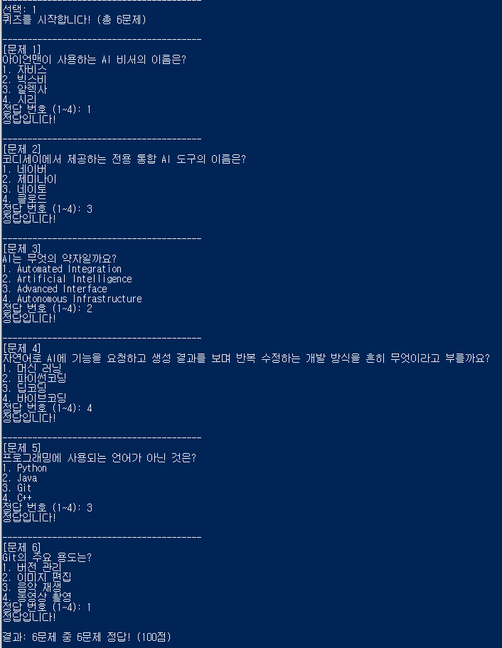
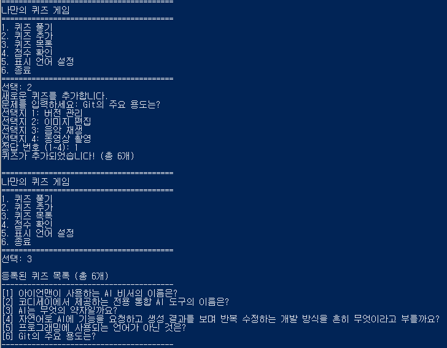
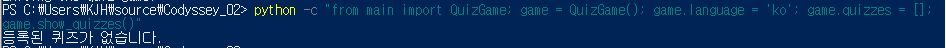

# Codyssey_02 — 나만의 퀴즈 게임

## 프로젝트 개요
Python으로 터미널에서 동작하는 퀴즈 게임을 만드는 학습 프로젝트입니다.
입력과 출력, 조건문, 반복문, 함수, 클래스, JSON 파일 저장을 학습합니다.
Git으로 기능별 변경 이력을 관리합니다.

## 현재 진행 상황
- 개발 환경 확인 완료
- GitHub 저장소 생성과 첫 업로드 완료
- 메뉴 표시, 번호 선택, 정상 종료 구현
- 잘못된 메뉴 입력 시 안내 후 다시 입력받도록 구현
- 표시 언어를 한국어와 영어 중 선택하고 설정을 저장하도록 구현
- 기본 퀴즈 5개 출제, 정답·오답 판정, 최종 점수 표시 구현
- 정답 입력 검증과 빈 퀴즈 목록 처리 구현
- Quiz와 QuizGame 클래스로 개별 문제와 게임 관리 역할 분리
- 퀴즈 추가 구현: 문제, 선택지 4개, 정답 번호를 입력받아 등록
- 문제와 선택지의 빈 입력 및 정답 번호의 잘못된 입력 처리
- 추가한 퀴즈를 같은 실행 중에 출제하도록 연결
- 퀴즈 목록 보기 구현: 등록된 문제 수와 문제 문장을 번호와 함께 표시
- 문제 목록이 비어 있으면 안내 메시지 출력
- 최고 점수 확인·state.json 저장은 구현 예정

## 개발 환경
- 운영체제: Windows
- Python: 3.13.17
- Git: 2.56.0.windows.4
- VS Code: 1.145.2
- 터미널: PowerShell

## 개발 환경 확인 화면


## 실행 방법
Python 3.10 이상이 필요합니다.
프로젝트 폴더에서 다음 명령을 실행합니다.

```powershell
python main.py
```

1번에서 기본 퀴즈 5개를 풀 수 있습니다.
각 문제의 정답 여부를 안내하며, 모든 문제를 풀면 정답 수와 100점 만점의 점수를 표시합니다.
2번에서 새 퀴즈를 등록할 수 있습니다.
문제, 선택지 4개, 정답 번호를 모두 입력하면 목록에 추가됩니다.
추가한 문제는 같은 실행 중에 1번을 선택하면 풀 수 있습니다.
현재는 파일 저장 전 단계이므로 종료 후 다시 실행하면 기본 문제 5개로 시작합니다.
3번에서 현재 등록된 퀴즈의 개수와 문제 목록을 확인할 수 있습니다.
같은 실행 중에 추가한 문제도 목록에 반영됩니다.
4번의 최고 점수 확인 기능은 구현 예정입니다.
5번에서 표시 언어를 설정하고, 6번에서 프로그램을 종료합니다.
표시 언어 설정은 프로젝트 폴더의 `language.json`에 저장되어 다음 실행에도 유지됩니다.
메뉴와 안내 메시지는 한국어와 영어로 표시할 수 있으며, 퀴즈 콘텐츠는 변경되지 않습니다.

## 메뉴 실행 화면






## 입력 및 종료 처리
- 숫자 입력 검증을 read_int() 함수로 분리했습니다.
- 앞뒤 공백, 빈 입력, 정수 변환 실패, 허용 범위 밖 입력을 처리합니다.
- Ctrl+C와 EOF 발생 시 안내 후 종료합니다.
- 종료 시 데이터 저장은 파일 저장 기능 구현 단계에서 추가할 예정입니다.
- 표시 언어는 메뉴의 5번 항목에서 설정하며, 한국어 또는 영어로 저장됩니다.

[기능 테스트 기록 보기](docs/test-results.md)

## 코드 구조

- main.py: QuizGame 클래스와 입력·출력·언어 설정·퀴즈 진행 함수를 정의합니다.
- quiz.py: 개별 문제를 표현하는 Quiz 클래스를 정의합니다.
- default_quizzes.py: 기본 퀴즈 5개를 Quiz 객체 목록으로 생성합니다.
- test_main.py: 언어 설정과 입력 검증 관련 자동 테스트를 정의합니다.
- 메서드: show_menu(), play_quiz(), add_quiz(), configure_language(), run()

### Quiz 클래스

문제 한 개를 관리합니다.

- 속성: question(문제), choices(선택지), answer(정답 번호)
- 메서드: display()(문제 출력), check_answer()(정답 확인)

### QuizGame 클래스

게임 전체의 상태와 메뉴 진행을 관리합니다.

- 속성: quizzes(문제 목록), best_score(최고 점수), language(표시 언어)
- 메서드: show_menu(), play_quiz(), add_quiz(), show_quizzes(), configure_language(), run()
- 객체를 생성하면 기본 문제 목록과 표시 언어를 준비합니다.
- 메뉴 표시와 퀴즈 풀기는 기존 함수를 활용합니다.
- 최고 점수는 아직 갱신하지 않으며 초기값은 None입니다.
- 최고 점수 관리와 state.json 저장·불러오기는 이후 구현할 예정입니다.

### 역할을 나눈 이유

Quiz는 문제 하나의 정보와 정답 확인을 담당하고,
QuizGame은 여러 문제를 가지고 게임을 진행합니다.

공통 숫자 입력 검증은 read_int() 함수로 분리하여
메뉴 선택과 정답 입력에서 재사용합니다.


## 퀴즈 주제와 선정 이유
- 주제: AI 기초
- 선정 이유: 이번 미션을 시작할 때 꼭 알아야할 정말 기초적인 내용을 선택했습니다.
- 기본 문제 수: 5개
- 문제 형식: 선택지 4개, 정답 번호 1~4

## 언어 설정 파일
- language.json은 프로젝트 폴더에 저장합니다.
- 파일이 없으면 한국어로 시작합니다.
- 파일이 손상되었거나 지원하지 않는 설정이면 안내 후 한국어로 시작합니다.
- 메뉴에서 언어를 선택하면 설정을 저장합니다.
- 개인별 설정 파일은 Git 기록에서 제외합니다.
- 퀴즈와 최고 점수의 state.json 저장 기능은 구현 예정입니다.

## 퀴즈 풀기 실행 화면









## 브랜치 작업과 병합

1. main에서 git checkout -b feature/play로 작업 브랜치를 생성했습니다.
2. feature/play에서 퀴즈 출제·채점·결과 표시 기능을 구현하고 커밋했습니다.
3. main으로 이동한 뒤 git merge --no-ff feature/play로 병합했습니다.
4. 병합한 main을 GitHub에 업로드했습니다.

--no-ff 옵션을 사용해 별도의 병합 커밋을 남겼습니다.



## 퀴즈 추가

- read_text()로 문제와 선택지의 앞뒤 공백을 제거하고 빈 입력을 거절합니다.
- read_int()로 정답 번호가 1~4 사이의 정수인지 확인합니다.
- 모든 입력이 끝난 뒤 Quiz 객체를 만들어 게임의 문제 목록에 추가합니다.
- 파일 저장과 재실행 후 데이터 유지는 이후 구현할 예정입니다.




## 퀴즈 목록 보기

- 메뉴 3번에서 등록된 문제 수와 문제 문장을 확인합니다.
- enumerate()를 사용해 문제에 1번부터 번호를 붙입니다.
- 빈 목록이면 안내 후 메뉴로 돌아갑니다.
- 목록 제목은 표시 언어를 따르며 문제 문장은 원문을 유지합니다.




