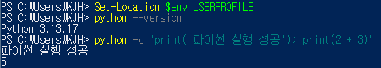

# Codyssey_02 — 나만의 퀴즈 게임

## 프로젝트 개요
Python으로 터미널에서 동작하는 퀴즈 게임을 만드는 학습 프로젝트입니다.
입력과 출력, 조건문, 반복문, 함수, 클래스, JSON 파일 저장을 학습합니다.
Git으로 기능별 변경 이력을 관리합니다.

## 현재 진행 상황
- 개발 환경 확인 완료
- 프로젝트 폴더와 Git 관리 준비
- 퀴즈 게임 기능은 구현 예정

## 개발 환경
- 운영체제: Windows
- Python: 3.13.17
- Git: 2.56.0.windows.4
- VS Code: 1.145.2
- 터미널: PowerShell

## 개발 환경 확인 화면

