# 기능 테스트 기록

기능을 구현하면서 수행한 수동 검사와 자동 테스트 결과를 기록합니다.
초기 개발 단계의 화면과 현재 화면은 메뉴 구성이 다를 수 있습니다.
현재 메뉴에서 5번은 표시 언어 설정, 6번은 종료입니다.

## 공통 숫자 입력과 종료 처리

아래 표는 초기 메뉴 구현 단계에서 수행한 검사입니다.

| 테스트 | 기대 결과 | 실제 판정 |
|---|---|---|
| 빈 입력 | 안내 후 재입력 | 통과 |
| 공백만 입력 | 빈 입력으로 처리 | 통과 |
| asdf 입력 | 정수 입력 안내 후 재입력 | 통과 |
| 1.5 입력 | 정수 입력 안내 후 재입력 | 통과 |
| 0 입력 | 범위 안내 후 재입력 | 통과 |
| 9 입력 | 범위 안내 후 재입력 | 통과 |
| 앞뒤 공백이 있는 1 입력 | 1번 선택 처리 | 통과 |
| 초기 메뉴의 5 입력 | 정상 종료 | 통과 |
| Ctrl+C | 안내 후 종료, 오류 추적 출력 없음 | 통과 |
| EOF | 안내 후 종료, 오류 추적 출력 없음 | 통과 |

퀴즈 정답 입력과 문제 등록의 입력 검증은 아래 각 기능 검사에서 확인했다.
현재 메뉴의 6번 종료는 QuizGame 클래스 검사에서 확인했다.
종료 시 저장과 재실행 후 데이터 유지는 ‘데이터 저장과 안전 종료’에 기록했다.

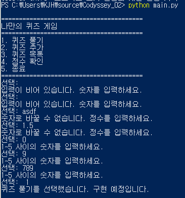

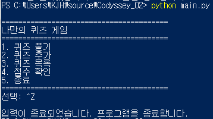

## 표시 언어 설정

실행 명령: `python -m unittest -v test_main`

실행 결과: 언어 설정 관련 테스트 8개 통과(OK)

이 자동 테스트 결과는 언어 설정 관련 검사를 의미하며,
퀴즈 게임의 모든 기능을 자동으로 검사했다는 뜻은 아니다.

| 테스트 | 기대 결과 | 실제 판정 |
|---|---|---|
| 설정 파일이 없음 | 한국어로 시작 | 통과 |
| 영어 설정 저장 후 불러오기 | 영어 설정 유지 | 통과 |
| 메뉴에서 영어 선택 | 영어 메뉴 표시 및 설정 저장 | 통과 |
| 영어 상태에서 빈 입력·문자·범위 밖 입력 | 영어 안내 후 재입력 | 통과 |
| 지원하지 않는 언어 설정 | 안내 후 한국어로 시작 | 통과 |
| 손상된 JSON | 안내 후 한국어로 시작 | 통과 |
| 잘못된 설정 데이터 구조 | 안내 후 한국어로 시작 | 통과 |
| 설정 파일 읽기 권한 오류 | 안내 후 한국어로 시작 | 통과 |

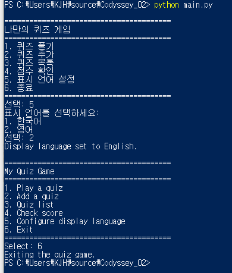

## Quiz 클래스

| 테스트 | 기대 결과 | 실제 판정 |
|---|---|---|
| python quiz.py 실행 | 문제와 선택지 4개 출력 | 통과 |
| 정답 번호 2 전달 | True 반환 | 통과 |
| 오답 번호 1 전달 | False 반환 | 통과 |
| import quiz 실행 | 확인용 문제가 자동 실행되지 않음 | 통과 |

## 기본 퀴즈 데이터

실행 명령: `python default_quizzes.py`

| 테스트 | 기대 결과 | 실제 판정 |
|---|---|---|
| 기본 퀴즈 생성 | 문제 5개 이상 생성 | 통과 |
| 문제 출력 | 모든 문제 문장과 선택지가 정상 출력 | 통과 |
| 선택지 개수 | 각 문제에 선택지 4개 | 통과 |
| 정답 번호 | 모든 정답 번호가 1~4 | 통과 |
| 문항 내용 검토 | 문항의 사실관계와 지정한 정답이 정확함 | 통과 |

기본 퀴즈의 정답 번호는 순서대로 1, 3, 2, 4, 3이다.
각 번호가 자비스, 네이토, Artificial Intelligence, 바이브코딩, Git을 가리키는지 확인했다.
네이토는 코디세이 모집 공고문의 전용 통합 AI 도구 설명과 대조했다.
프로그램이 정상적으로 출력되는지와 문항 내용이 정확한지는 구분해서 확인한다.
과정 전용 도구의 이름은 교육 과정 안내와 대조한다.

## 퀴즈 풀기

기본 퀴즈 5개를 대상으로 검사했다.

| 테스트 | 기대 결과 | 실제 판정 |
|---|---|---|
| 메뉴에서 퀴즈 풀기 선택 | 기본 문제 5개 출제 | 통과 |
| 5문제 모두 정답 | 100점 표시 | 통과 |
| 5문제 중 1문제 오답 | 오답 안내와 80점 표시 | 통과 |
| 모든 문제 풀이 완료 | 메뉴로 복귀 | 통과 |
| 정답에 빈 입력·공백만 입력 | 안내 후 같은 문제에서 재입력 | 통과 |
| 정답에 abc·1.5 입력 | 정수 입력 안내 후 재입력 | 통과 |
| 정답에 0·5 입력 | 범위 안내 후 재입력 | 통과 |
| 앞뒤 공백이 있는 정답 번호 | 공백 제거 후 채점 | 통과 |
| 빈 퀴즈 목록 전달 | 등록된 퀴즈가 없다는 안내 | 통과 |

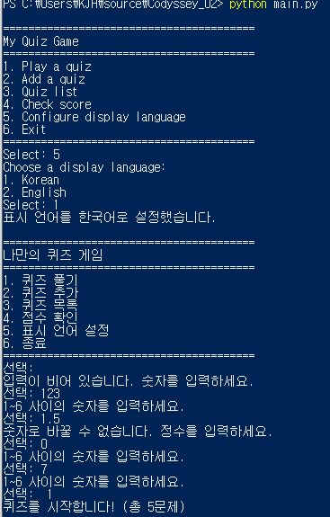

## QuizGame 클래스 구조 변경 후 확인

아래 결과는 파일 저장 기능을 연결하기 전 검사 기록이다.
현재는 정상적인 저장 파일이 있으면 저장된 문제와 최고 점수를 불러온다.

| 테스트 | 기대 결과 | 실제 판정 |
|---|---|---|
| QuizGame 객체 생성 | 기본 문제 5개 준비 | 통과 |
| 최고 점수 초기값 확인 | None | 통과 |
| 기존 언어 자동 테스트 | 8개 모두 통과 | 통과 |
| 메뉴에서 퀴즈 시작 | 기본 문제 5개 출제 | 통과 |
| 모두 정답 입력 | 100점 표시 | 통과 |
| 풀이 완료 | 메뉴로 복귀 | 통과 |
| 메뉴 6번 선택 | 정상 종료 | 통과 |
| 객체의 문제 목록을 비운 뒤 실행 | 빈 목록 안내 | 통과 |

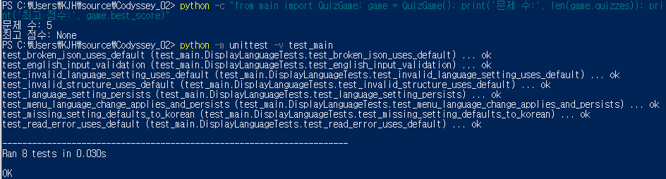

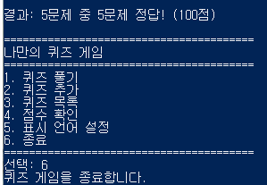

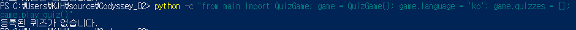

## 퀴즈 추가

| 테스트 | 기대 결과 | 실제 판정 |
|---|---|---|
| 문제를 비워서 입력 | 안내 후 재입력 | 통과 |
| 선택지를 비워서 입력 | 안내 후 재입력 | 통과 |
| 정답 번호에 빈 입력 | 안내 후 재입력 | 통과 |
| 정답 번호에 문자·1.5 입력 | 정수 입력 안내 후 재입력 | 통과 |
| 정답 번호에 0·5 입력 | 1~4 범위 안내 후 재입력 | 통과 |
| 공백이 포함된 정답 번호 입력 | 공백 제거 후 정상 처리 | 통과 |
| 문제·선택지 4개·정답 등록 | 문제 수가 5개에서 6개로 증가 | 통과 |
| 추가 후 퀴즈 풀기 | 새 문제가 6번째로 출제 | 통과 |
| 6문제 모두 정답 | 100점 표시 | 통과 |
| 기존 언어 자동 테스트 | 8개 모두 통과 | 통과 |

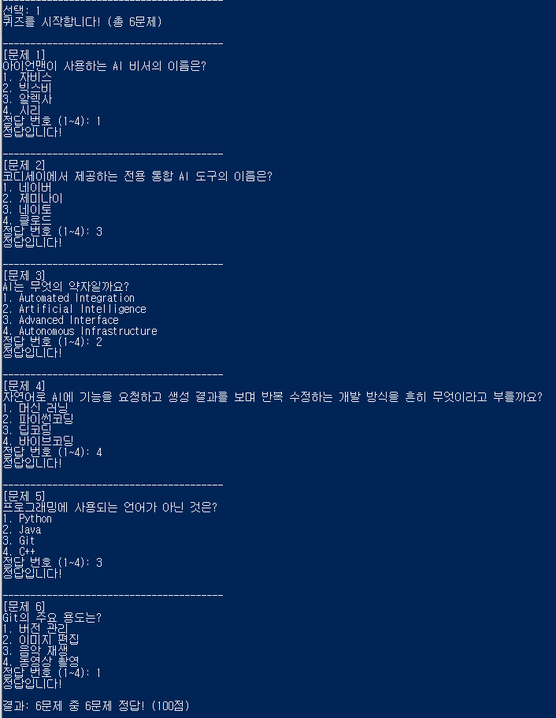

추가한 퀴즈의 재실행 후 유지 여부는 ‘데이터 저장과 안전 종료’에 기록했다.

## 퀴즈 목록 보기

| 테스트 | 기대 결과 | 실제 판정 |
|---|---|---|
| 기본 상태에서 메뉴 3번 선택 | 문제 5개와 번호 표시 | 통과 |
| 새 문제 등록 후 목록 확인 | 총 6개와 추가한 문제 표시 | 통과 |
| 영어 설정에서 목록 확인 | 영어 제목과 원문 문제 표시 | 통과 |
| 빈 문제 목록 확인 | 등록된 퀴즈가 없다는 안내 | 통과 |
| 목록 출력 완료 | 메뉴로 복귀 | 통과 |

## 최고 점수

최고 점수 기록이 없는 상태에서 시작해 순서대로 검사했다.

| 테스트 | 기대 결과 | 실제 판정 |
|---|---|---|
| 플레이 전 메뉴 4번 선택 | 아직 완료한 게임이 없다는 안내 | 통과 |
| 첫 게임에서 모두 오답 | 0점을 첫 최고 점수로 등록 | 통과 |
| 0점 기록 후 메뉴 4번 선택 | 최고 점수 0점 표시 | 통과 |
| 다음 게임에서 모두 정답 | 최고 점수를 100점으로 갱신 | 통과 |
| 이후 게임에서 80점 획득 | 최고 점수 100점 유지 | 통과 |
| 기존 언어 자동 테스트 | 8개 모두 통과 | 통과 |

None은 아직 완료한 게임이 없다는 뜻이다.
0은 게임을 끝까지 풀었지만 정답이 없어서 받은 점수다.
두 상태를 구분해서 처리한다.

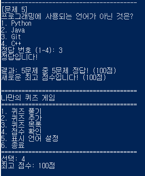

## 데이터 저장과 안전 종료

아래 종료·손상 검사는 원래 프로젝트를 복사한 임시 폴더에서 수행했다.
종료 검사 시작 시 저장 데이터는 퀴즈 6개, 최고 점수 100점이었다.

| 테스트 | 기대 결과 | 실제 판정 |
|---|---|---|
| 풀이 중 Ctrl+C | 안내 후 저장하고 종료 | 통과 |
| Ctrl+C 후 재실행 | 퀴즈 6개와 최고 점수 100점 유지 | 통과 |
| 등록 도중 EOF | 안내 후 저장하고 종료 | 통과 |
| EOF 후 재실행 | 기존 데이터 유지, 미완성 문제 미등록 | 통과 |
| 손상된 저장 파일 | 손상 파일 백업 후 기본 데이터로 실행 | 통과 |
| 손상 처리 후 재실행 | 손상 안내 없이 기본 퀴즈 5개 불러오기 | 통과 |

### 손상 파일 처리 결과

- JSON 문법이 잘못된 파일을 읽으면 안내 메시지를 표시했다.
- 손상 파일을 state.json.corrupt-날짜와시간.bak 형태로 보관했다.
- 기본 퀴즈 5개와 최고 점수 기록이 없는 상태로 시작했다.
- 종료할 때 정상적인 state.json을 새로 저장했다.
- 새 파일의 best_score는 null이었다.

null은 최고 점수 기록이 없다는 뜻이며 Python의 None에 대응한다.
손상 파일 백업은 원본 내용을 보관하는 기능이다.
손상되기 전의 퀴즈와 점수를 자동으로 복원하는 기능은 아니다.

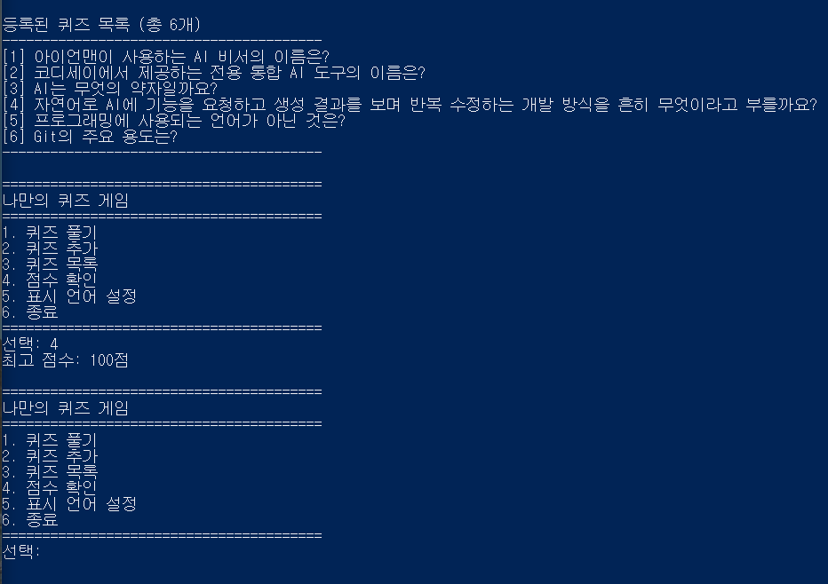

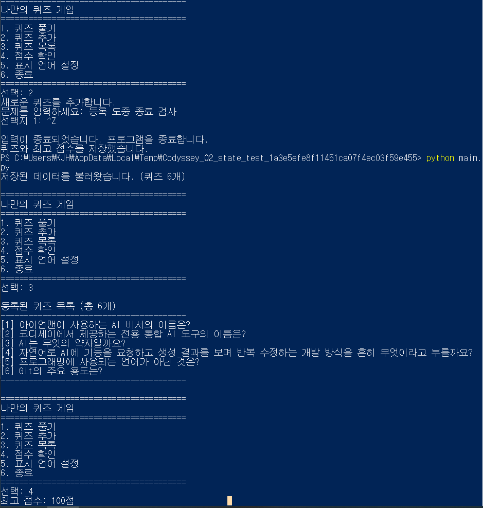

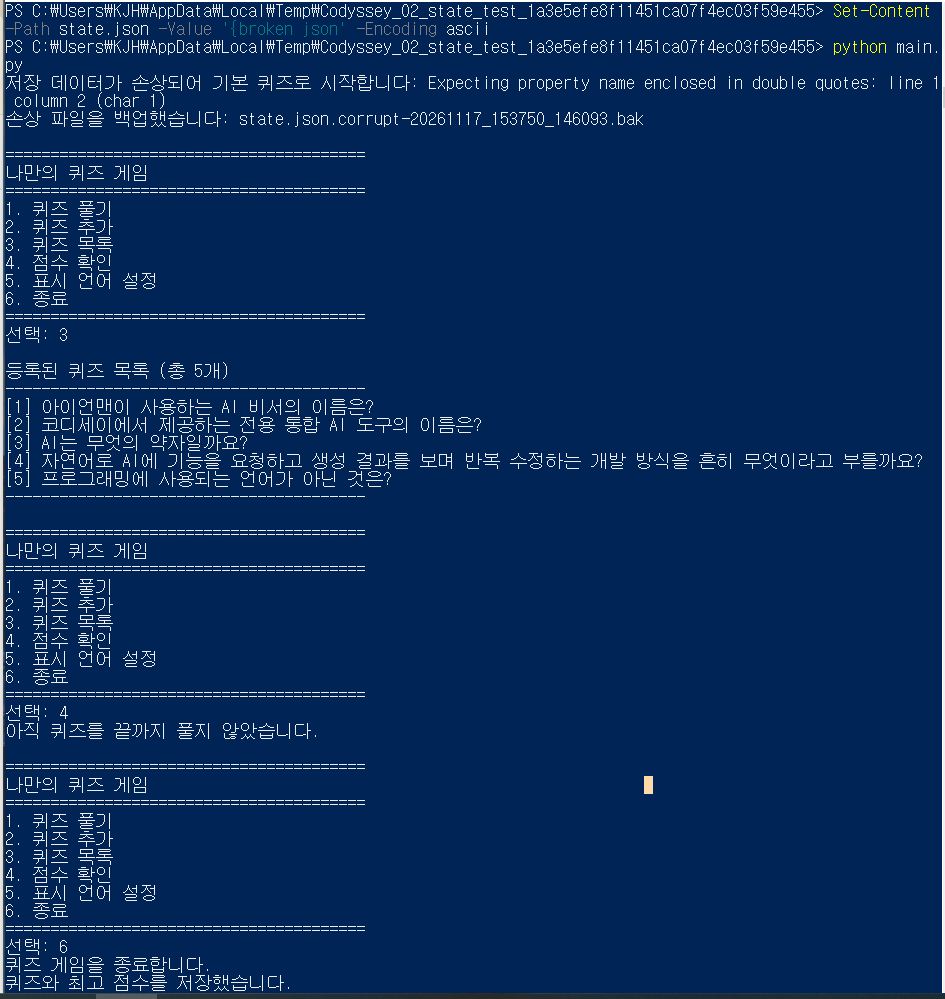

## 저장 파일이 없는 첫 실행

GitHub 저장소를 Codyssey_02_clone 폴더에 복제한 뒤 검사했다.

| 테스트 | 기대 결과 | 실제 판정 |
|---|---|---|
| 실행 전 state.json 확인 | Test-Path 결과 False | 통과 |
| 저장 파일 없이 실행 | 안내 후 기본 퀴즈 5개로 시작 | 통과 |
| 첫 실행에서 점수 확인 | 아직 완료한 게임이 없다는 안내 | 통과 |
| 정상 종료 후 파일 확인 | Test-Path 결과 True | 통과 |
| 저장 파일 생성 후 Git 상태 | working tree clean 유지 | 통과 |

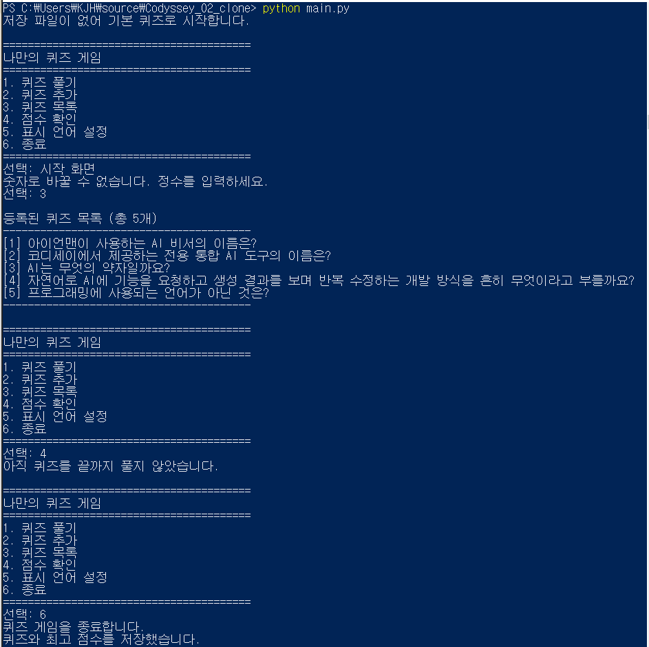

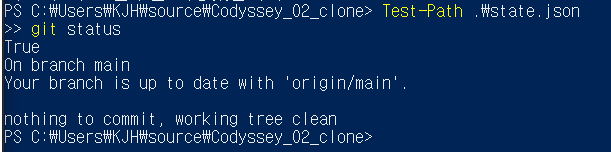

## clone과 pull 실습

| 테스트 | 기대 결과 | 실제 판정 |
|---|---|---|
| 별도 폴더에 clone | 저장소 복제 성공 | 통과 |
| 복제본에서 README 수정 후 commit과 push | 원격 저장소에 새 커밋 반영 | 통과 |
| 원래 폴더에서 pull | 원격 변경을 원래 작업 폴더에 반영 | 통과 |
| 문장과 커밋 번호 확인 | 추가한 문장과 fbdcca8 커밋 확인 | 통과 |

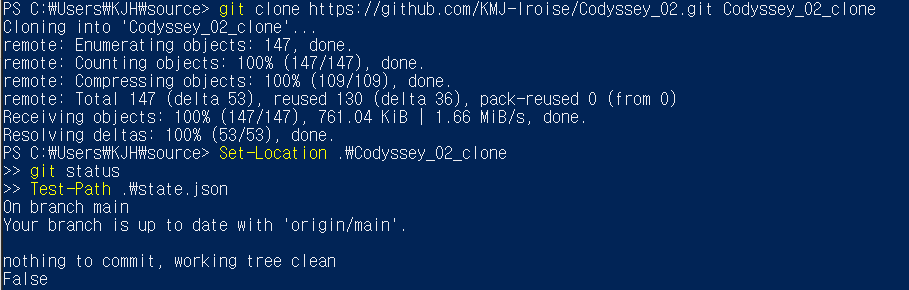

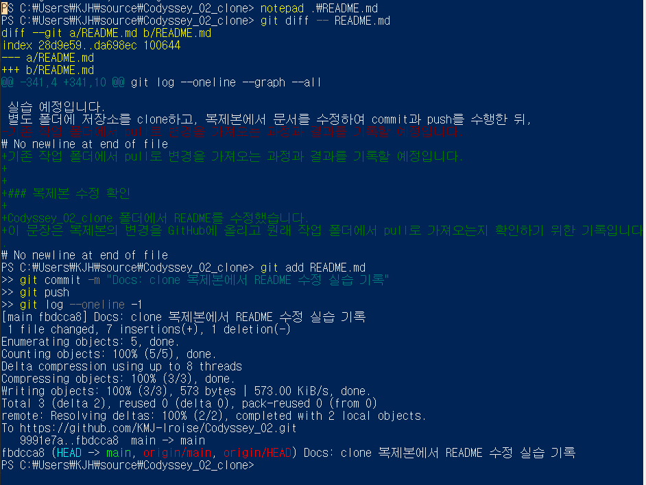

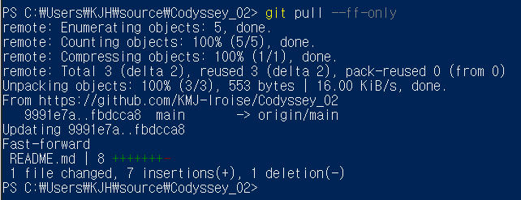

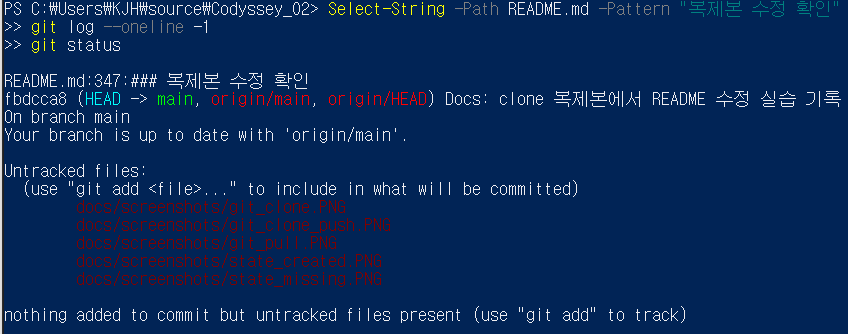

## 저장 파일 오류 처리 자동 테스트

실행 명령: `python -m unittest -v test_main test_state`

실행 결과: 언어 설정 검사 8개와 저장 오류 검사 4개, 총 12개 통과(OK).

별도의 임시 폴더에서 검사용 데이터를 사용했다.
unittest.mock.patch로 파일 작업의 실패 상황을 만들었다.

| 테스트 | 기대 결과 | 실제 판정 |
|---|---|---|
| 저장 파일 읽기 실패 | 기본 퀴즈로 시작하고 저장을 막아 기존 파일 보호 | 통과 |
| 임시 파일 쓰기 실패 | 저장 실패 처리 및 기존 파일 내용 유지 | 통과 |
| 저장 파일 교체 실패 | 저장 실패 처리 및 기존 파일 내용 유지 | 통과 |
| 손상 파일 백업 실패 | 저장을 막고 손상 파일 내용 유지 | 통과 |

실패 처리는 모의 오류로 검사했으며 실제 디스크 고장이나
운영체제의 권한 설정을 변경한 검사는 아니다.

