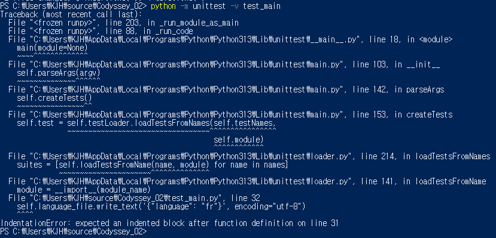
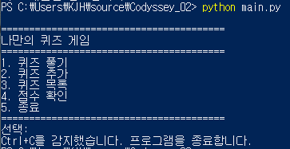
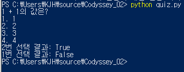
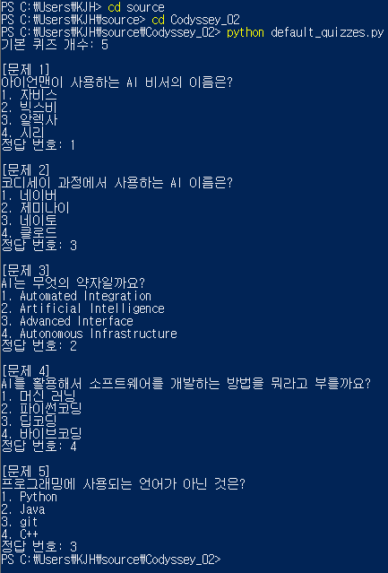
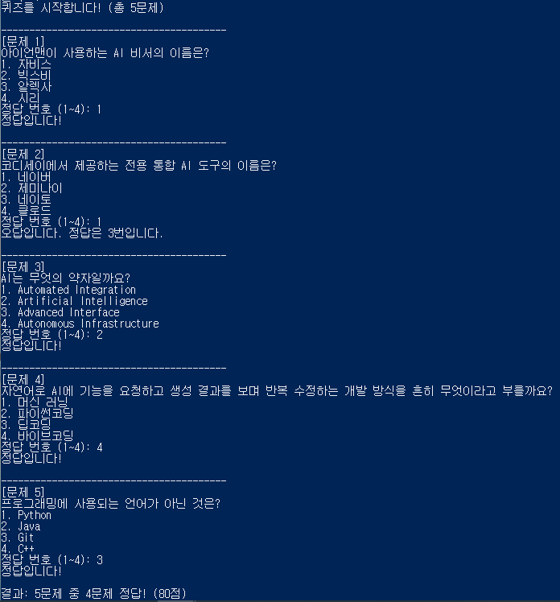
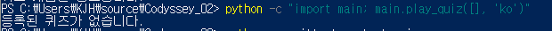
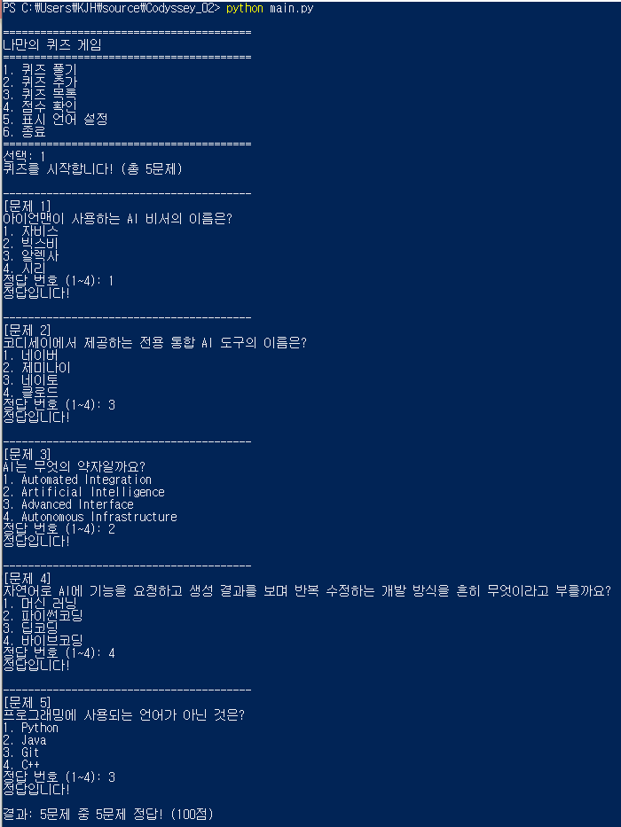

# 기능 테스트 기록

## 공통 숫자 입력과 종료 처리

| 테스트 | 기대 결과 | 실제 판정 |
|---|---|---|
| 빈 입력 | 안내 후 재입력 | 통과 |
| 공백만 입력 | 빈 입력으로 처리 | 통과 |
| asdf 입력 | 정수 입력 안내 후 재입력 | 통과 |
| 1.5 입력 | 정수 입력 안내 후 재입력 | 통과 |
| 0 입력 | 범위 안내 후 재입력 | 통과 |
| 9 입력 | 범위 안내 후 재입력 | 통과 |
| 앞뒤 공백이 있는 1 입력 | 1번 선택 처리 | 통과 |
| 5 입력 | 정상 종료 | 통과 |
| Ctrl+C | 안내 후 종료, 오류 추적 출력 없음 | 통과 |
| EOF | 안내 후 종료, 오류 추적 출력 없음 | 통과 |

현재는 메뉴 입력에서 검사했다.
퀴즈 정답 입력과 문제 등록에도 연결한 뒤 다시 검사할 예정이다.
종료 시 데이터 저장 여부는 파일 저장 기능 구현 후 별도로 검사한다.

## 표시 언어 설정

실행 명령: `python -m unittest -v test_main`
실행 결과: 테스트 8개 통과(OK)

| 테스트 | 기대 결과 | 실제 판정 |
|---|---|---|
| 설정 파일이 없음 | 한국어로 시작 | 통과 |
| 영어 설정 저장 후 불러오기 | 영어 설정 유지 | 통과 |
| 메뉴에서 영어 선택 | 영어 메뉴 표시 및 설정 저장 | 통과 |
| 영어 상태에서 빈 입력·문자·범위 밖 입력 | 영어 안내 후 재입력 | 통과 |
| 지원하지 않는 언어 설정 | 안내 후 한국어로 시작 | 통과 |
| 손상된 JSON | 안내 후 한국어로 시작 | 통과 |
| 잘못된 설정 데이터 구조 | 안내 후 한국어로 시작 | 통과 |
| 설정 파일 읽기 권한 오류 | 안내 후 한국어로 시작 | 통과 |

## 확인 화면

## Quiz 클래스

| 테스트 | 기대 결과 | 실제 판정 |
|---|---|---|
| python quiz.py 실행 | 문제와 선택지 4개 출력 | 미확인 |
| 정답 번호 2 전달 | True 반환 | 미확인 |
| 오답 번호 1 전달 | False 반환 | 미확인 |
| import quiz 실행 | 확인용 문제가 자동 실행되지 않음 | 미확인 |

## 기본 퀴즈 데이터

| 테스트 | 기대 결과 | 실제 판정 |
|---|---|---|
| 기본 퀴즈 생성 | 문제 5개 이상 생성 | 미확인 |
| 문제 출력 | 모든 문제 문장과 선택지가 정상 출력 | 미확인 |
| 선택지 개수 | 각 문제에 선택지 4개 | 미확인 |
| 정답 번호 | 모든 정답 번호가 1~4 | 미확인 |
| 정답 내용 검토 | 정답 번호가 실제 정답 선택지를 가리킴 | 미확인 |

## 퀴즈 풀기

| 테스트 | 기대 결과 | 실제 판정 |
|---|---|---|
| 메뉴에서 퀴즈 풀기 선택 | 기본 문제 5개 출제 | 통과 |
| 5문제 모두 정답 | 100점 표시 | 통과 |
| 5문제 중 1문제 오답 | 오답 안내와 80점 표시 | 통과 |
| 모든 문제 풀이 완료 | 메뉴로 복귀 | 통과 |
| 정답에 빈 입력·공백만 입력 | 안내 후 같은 문제에서 재입력 | 통과 |
| 정답에 abc·1.5 입력 | 정수 입력 안내 후 재입력 | 통과 |
| 정답에 0·5 입력 | 범위 안내 후 재입력 | 통과 |
| 앞뒤 공백이 있는 정답 번호 | 공백 제거 후 채점 | 통과 |
| 빈 퀴즈 목록 전달 | 등록된 퀴즈가 없다는 안내 | 통과 |

최고 점수 저장과 재실행 후 데이터 유지는 파일 저장 기능 구현 후 검사할 예정입니다.

## QuizGame 클래스 구조 변경 후 확인

| 테스트 | 기대 결과 | 실제 판정 |
|---|---|---|
| QuizGame 객체 생성 | 기본 문제 5개 준비 | 통과 |
| 최고 점수 초기값 확인 | None | 통과 |
| 기존 언어 자동 테스트 | 8개 모두 통과 | 통과 |
| 메뉴에서 퀴즈 시작 | 기본 문제 5개 출제 | 통과 |
| 모두 정답 입력 | 100점 표시 | 통과 |
| 풀이 완료 | 메뉴로 복귀 | 통과 |
| 메뉴 6번 선택 | 정상 종료 | 통과 |
| 객체의 문제 목록을 비운 뒤 실행 | 빈 목록 안내 | 통과 |

